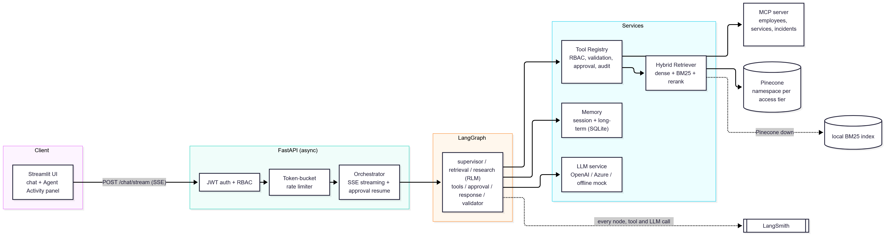

# Enterprise AI Assistant

An open, extensible enterprise knowledge assistant. The bundled demo persona is a generic commercial bank (configurable, see Branding). It answers questions over internal
documents (policies, runbooks, incident reports, architecture documents, product specifications, meeting notes),
calls enterprise tools, cites its evidence, and enforces role-based access to both documents and tools.

Demo video (45 min): [Watch on Loom](https://www.loom.com/share/1195bcbc988242b28076507e44b4b92d)

## Features

- Multi-agent LangGraph graph with a human approval step for write tools
- Hybrid retrieval (dense + BM25) on Pinecone, one namespace per access tier, reranking, metadata filters
- Recursive Language Model research agent for questions that span many documents
- Tools: knowledge search, pandas analysis, MCP server with dummy enterprise data
- JWT auth, role-based access to documents and tools, prompt-injection and citation guardrails, token-bucket rate limiting
- Session and long-term memory with feedback-weighted recall
- Graceful degradation when the LLM, Pinecone or MCP is unavailable
- LangSmith tracing, structured logs, and a live Agent Activity panel in the UI

## Architecture overview



More diagrams and the design write-up are in [docs/](docs/): [architecture](docs/architecture.md),
[design decisions](docs/design-decisions.md) and [security](docs/security.md).

## Quick start (no API keys needed)

Requires Python 3.11 or newer.

```bash
python -m venv .venv
source .venv/bin/activate            # Windows: .venv\Scripts\activate
pip install -r requirements.txt
cp .env.example .env                 # Windows: copy .env.example .env

uvicorn app.main:app --port 8000     # terminal 1 (first start builds the index automatically)
streamlit run ui/streamlit_app.py    # terminal 2, opens http://localhost:8501
```

With empty keys the app runs in offline mode: a deterministic mock LLM and a local vector store. Every feature works,
but answers are extractive. The activity panel shows which LLM provider and vector backend are active.

### Demo users and roles

| user | password | role | can use | can read |
|---|---|---|---|---|
| viewer | viewer123 | viewer | chat, search | public, internal |
| analyst | analyst123 | analyst | + analytics, MCP read tools | + confidential |
| admin | admin123 | administrator | all tools (writes need approval) | + restricted |

Documents are tagged `public`, `internal`, `confidential` or `restricted`, and each tier is a Pinecone namespace.
The demo users are hard-coded for local use. For a shared deployment, replace `authenticate()` and `decode_token()` in `app/security/auth.py`
with your identity provider; the RBAC code does not change.

## Configuration

Settings are environment variables; `.env.example` lists all of them with comments. The ones you are most likely to change:

| Variable | Purpose |
|---|---|
| `LLM_PROVIDER` | `auto` (default), `openai`, `azure`, `mock` |
| `VECTOR_BACKEND` | `auto` (Pinecone if a key is set), `pinecone`, `local` |
| `HYBRID_ALPHA`, `HYBRID_MODE` | dense/sparse weight; `fusion` (two queries, explainable) or `native` (one query) |
| `ORG_NAME`, `ASSISTANT_NAME` | persona used in the system prompt and greetings |
| `JWT_SECRET` | signing key for access tokens (set a long random value) |
| `RATE_LIMITS` | per-role token bucket (JSON: capacity, refill_per_sec) |
| `MCP_TRANSPORT`, `MCP_URL` | `stdio` (spawned on demand) or `http` (separate server) |
| `RLM_CONTEXT_CHARS`, `RLM_MAX_DEPTH` | RLM recursion tuning |
| `TODAY_OVERRIDE` | pin the date so relative phrases like "last year" are reproducible |

### Using real services

```ini
OPENAI_API_KEY=sk-...
PINECONE_API_KEY=...
LANGSMITH_TRACING=true
LANGSMITH_API_KEY=lsv2_...
LANGSMITH_PROJECT=enterprise-ai-assistant
```

For Azure OpenAI, use these instead of `OPENAI_API_KEY`:

```ini
LLM_PROVIDER=azure
AZURE_OPENAI_API_KEY=...
AZURE_OPENAI_ENDPOINT=https://<resource>.openai.azure.com/openai/v1
AZURE_DEPLOYMENT_FAST=<chat deployment>
AZURE_DEPLOYMENT_STRONG=<chat deployment>      # can be the same deployment
AZURE_DEPLOYMENT_EMBEDDING=<embedding deployment>
```

Check that every service is reachable, load the documents, then start the API:

```bash
python -m scripts.check_connections
python -m app.ingestion.ingest       # embeds chunks, writes data/index, upserts to Pinecone namespaces
uvicorn app.main:app --port 8000
```

Changing the LLM provider or embedding model changes vector dimensions, so re-run the ingest (or delete the Pinecone index first if the dimension changed).
`curl localhost:8000/ready` reports the active LLM provider and vector backend.

## Try it

Log in as `analyst` and ask:

1. `What is the password and MFA standard for employees?`
2. `Summarize all outage reports related to payment failures during the last year and identify recurring root causes.`
3. `Who is on call for payment-gateway, and what does its runbook say to do first when latency spikes?`
4. `How many incidents were there by root cause and what was the average duration?`

Log in as `admin` and ask `Please create an incident ticket for card-processing latency spikes` to see the approval step.
Ask a restricted-topic question as `viewer` and as `admin` to compare what each role can see.

## Branding and adapting to your organization

Set `ORG_NAME` and `ASSISTANT_NAME` in `.env`. The tone rules, banned phrases and regulatory disclaimer live in `app/brand.py`;
edit them to match your industry. The bundled documents, departments and services (`app/domain.py`, `scripts/generate_sample_data.py`)
are demo data to replace with your own.

## Your own documents

Put Markdown files with YAML front matter in `data/sample_docs/` and run `python -m app.ingestion.ingest`.

```markdown
---
doc_id: POL-001
title: Example Policy
department: payments
document_type: policy
access_level: internal
created_date: 2026-01-15
---
# Example Policy
## Section heading
Body text...
```

Required fields: `doc_id`, `title`, `department`, `document_type`, `access_level`, `created_date`.
Optional incident fields: `service`, `severity`, `root_cause_category`, `duration_minutes`.
To regenerate the bundled sample corpus: `python scripts/generate_sample_data.py`.

## MCP server

By default the API spawns the MCP server over stdio per call. To run it as a separate process:

```bash
MCP_SERVER_TRANSPORT=streamable-http MCP_HOST=127.0.0.1 python -m app.mcp_server.server
# .env: MCP_TRANSPORT=http  MCP_URL=http://127.0.0.1:8765/mcp
```

Tools: `search_employees`, `list_services`, `get_service`, `list_incidents`, `get_incident`, `create_incident_ticket` (write).

## Docker Compose

```bash
cp .env.example .env
docker compose up --build                 # API :8000, UI :8501, MCP :8765
docker compose run --rm ingest            # rebuild index / push to Pinecone
```

## Tests

```bash
python -m pytest -q
```

The suite runs fully offline (mock LLM, local vector store) and includes failure-injection tests for the LLM, vector database and MCP server.

## API

`POST /auth/login`, `GET /me`, `POST /chat/stream` (server-sent events), `POST /chat/approve` (server-sent events),
`GET /sessions/{id}/memory`, `POST /feedback`, `GET /health`, `GET /ready`, and admin endpoints
`GET /admin/audit`, `GET /admin/feedback`, `POST /admin/reindex`. Interactive docs at `http://localhost:8000/docs`.

## Project layout

See the code map in [docs/architecture.md](docs/architecture.md). In short: `app/` (API, agents, retrieval, tools, security), `ui/` (Streamlit), `data/`, `docs/`, `scripts/`, `tests/`.

## Troubleshooting

| Symptom | Fix |
|---|---|
| UI says the API is not reachable | start `uvicorn` first and check `API_URL` |
| Pinecone dimension mismatch | delete the index in the Pinecone console or change `PINECONE_INDEX` |
| `NotImplementedError` from asyncio subprocess on Windows | use WSL or Docker (developed and tested on Linux) |
| `mcp` import errors | keep `mcp<2` (version 2 renamed the server API) |
| HTTP 429 | expected rate limiting; tune `RATE_LIMITS` |
| Azure `404 Resource not found` | check `AZURE_OPENAI_ENDPOINT` and that the `AZURE_DEPLOYMENT_*` names match your deployment names exactly |
| Pinecone upsert times out | lower `PINECONE_UPSERT_BATCH` (for example 5) and re-run ingest |
| Not sure what is misconfigured | run `python -m scripts.check_connections` |
