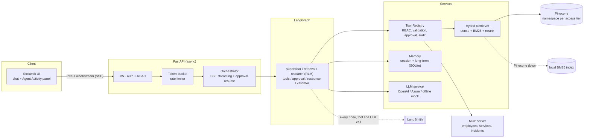
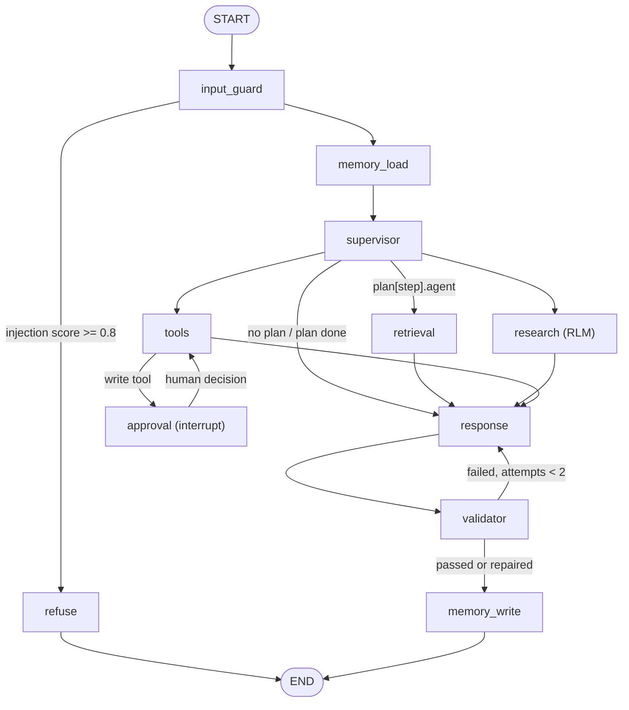
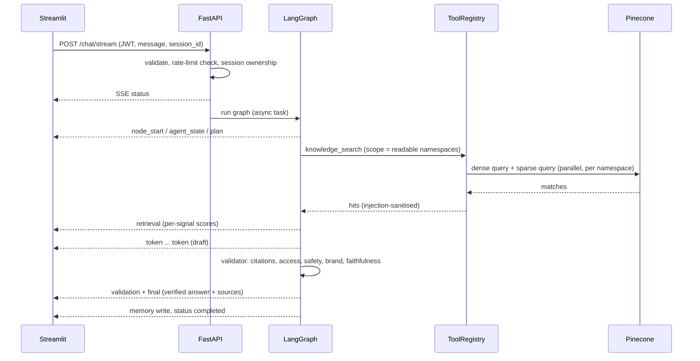
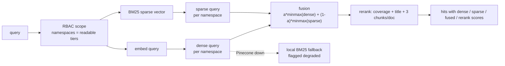
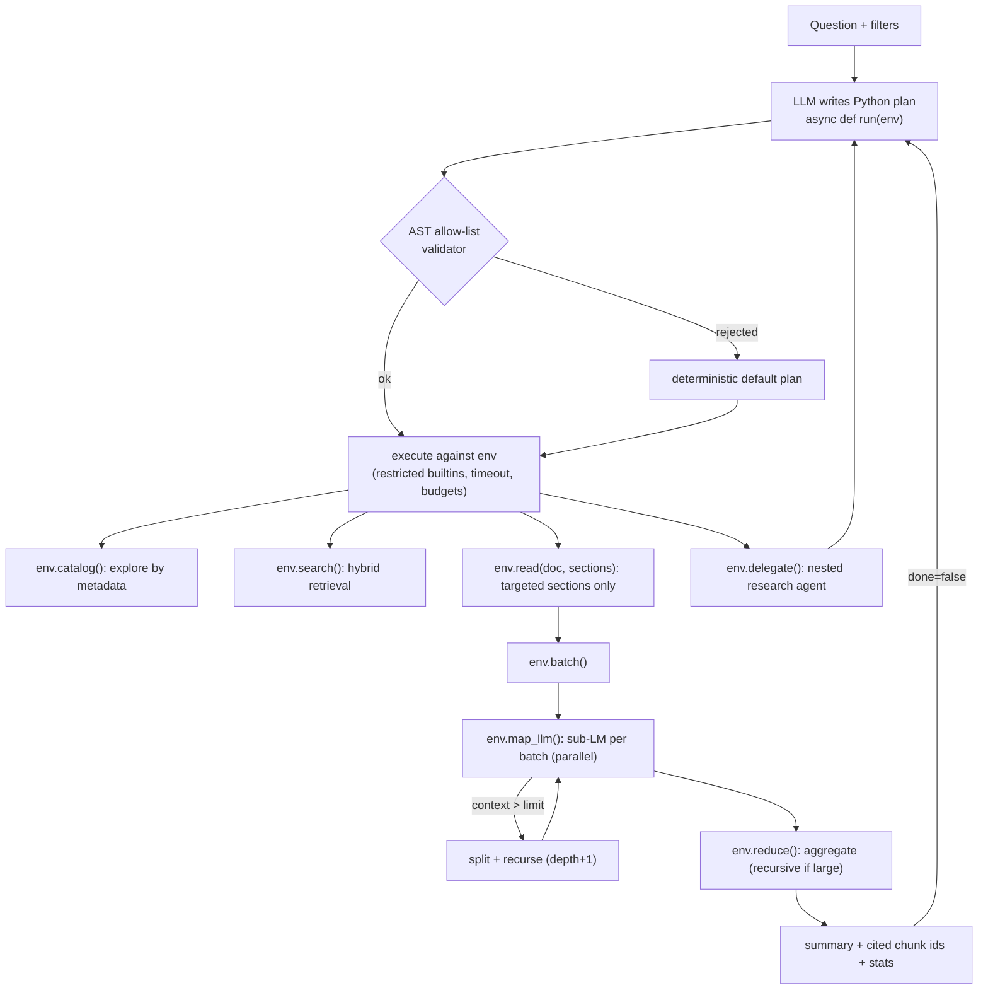

# Architecture

A Streamlit UI streams each chat turn from a FastAPI backend. The backend runs a LangGraph graph of specialised agents.
Retrieval is hybrid (dense plus BM25) on Pinecone, with one namespace per access tier. Every step is traced in LangSmith
and streamed to the UI as events, which is what the Agent Activity panel shows.

## System



## The graph



The topology is fixed so it is easy to audit and test. The path through it is decided per request: the supervisor writes a plan
(retrieval, research, tools) and a router walks it. Each agent writes only its own state keys. Every node is wrapped so an exception
marks that agent as failed and the plan continues, instead of crashing the run.

The `approval` node uses LangGraph `interrupt()` with a checkpointer. The run pauses, the API sends `approval_required`, and
`POST /chat/approve` resumes the same run.

## One chat turn



## Retrieval

1. The role decides which namespaces may be searched (`public`, `internal`, `confidential`, `restricted`). The model never builds the filter.
2. The query is embedded for the dense search, and encoded as a BM25 sparse vector for the keyword search. Both run per namespace, in parallel.
3. Scores are min-max normalised and combined: `alpha * dense + (1 - alpha) * sparse` (`HYBRID_ALPHA`, default 0.6). Native Pinecone scaling is available with `HYBRID_MODE=native`.
4. A light reranker rewards query coverage and title matches and limits chunks per document.
5. If Pinecone is down, search falls back to the local index and the answer is flagged as degraded.



Chunks keep their section, so the research agent can read just one section of many documents. The record metadata is described under Data model.

## Recursive research (RLM)

For broad questions, the research agent does not put documents in a prompt. The model writes a short Python program,
`async def run(env)`, that explores the collection through a small API:

| Call | Use |
|---|---|
| `catalog` | list documents by metadata, no text |
| `search`, `grep` | semantic or exact lookup |
| `read(doc, sections)` | read only the named sections |
| `batch`, `map_llm` | split documents into batches, one sub-model call per batch, in parallel |
| `reduce` | combine partial results |
| `delegate` | start a nested research agent for a sub-question |



If a batch is larger than `RLM_CONTEXT_CHARS`, it is split and processed again one level deeper (up to `RLM_MAX_DEPTH`).
The program is checked against an AST allow-list (no imports, loops that can hang, dunder access) and runs with a time limit and budgets for searches,
sub-model calls and depth. If the plan is rejected or fails, a deterministic default plan runs instead. Everything that was read is recorded as evidence, so the final
citations can be verified.

Simplified compared with the research idea: at most two plan steps, recursion through explicit map/reduce/delegate, and an in-process sandbox.

## Data model

Pinecone uses one hybrid index (`metric=dotproduct`, dense 1536 dimensions plus sparse values). The namespace is the access tier.
Each record carries this metadata:

```json
{"chunk_id": "INC-2026-031#4", "doc_id": "INC-2026-031",
 "title": "payment-gateway outage - expired TLS certificate", "section": "Root Cause",
 "department": "payments", "document_type": "incident", "access_level": "confidential",
 "created_date": "2026-06-21", "created_ts": 739788,
 "service": "payment-gateway", "severity": "sev1",
 "root_cause_category": "expired TLS certificate", "duration_minutes": 187,
 "text": "Root cause: ..."}
```

Source documents are Markdown files in `data/sample_docs/` with front matter (`doc_id`, `department`, `document_type`, `access_level`, `created_date`). Ingestion chunks them by section,
embeds the chunks, builds the sparse vectors, saves a local copy in `data/index` (used for the fallback) and upserts to Pinecone.

SQLite (`data/app.db`) holds three tables: `memories` (episodes and preferences with the access level and a feedback weight), `feedback` (ratings and comments) and `audit` (security and tool events).

## Roles

| Role | Can do | Reads |
|---|---|---|
| viewer | chat, search | public, internal |
| analyst | + analytics, MCP read tools | + confidential |
| administrator | everything, write tools after approval | + restricted |

## Events

Each step emits an event, and the UI only renders these.

| Type | Meaning |
|---|---|
| `status` | started, resumed or completed; trace run id, provider, backend |
| `node_start`, `node_end`, `agent_state` | active LangGraph node, status, duration, degradations |
| `plan` | intent, plan steps, filters, allowed tools |
| `retrieval` | scope, mode, candidates, dense/sparse/fused/rerank scores, degraded flag |
| `tool_call`, `tool_result` | tool, arguments, required permission, status, duration |
| `rlm` | plan source and code, catalog, search, read, batch, map, split, aggregate, delegate, stats |
| `guardrail` | injection blocked or quarantined, authorisation denied, answer repaired |
| `memory` | read (turns, summary, recalled items) and write (stored items, compression) |
| `validation` | per-stage results: citations, safety, brand, faithfulness |
| `token`, `token_reset` | streamed draft tokens, and clearing the draft on regeneration |
| `approval_required`, `final`, `error` | approval pause, verified answer with citations, structured error |

## Code map

```
app/api/routes.py, app/services/orchestrator.py   endpoints, SSE, run and resume a turn
app/agents/                graph.py, nodes_*.py, state.py
app/agents/rlm/            planner.py, env.py, runner.py, runtime.py
app/retrieval/             sparse.py, stores.py, hybrid.py, catalog.py, filters.py
app/tools/                 base.py (registry), builtin.py, sandbox.py, mcp_client.py
app/mcp_server/server.py   dummy enterprise data
app/memory/manager.py      session and long-term memory
app/security/              rbac, auth, rate_limit, injection, guardrails, validation, audit
app/llm/service.py         OpenAI, Azure and mock providers
ui/streamlit_app.py        chat and Agent Activity panel
```
