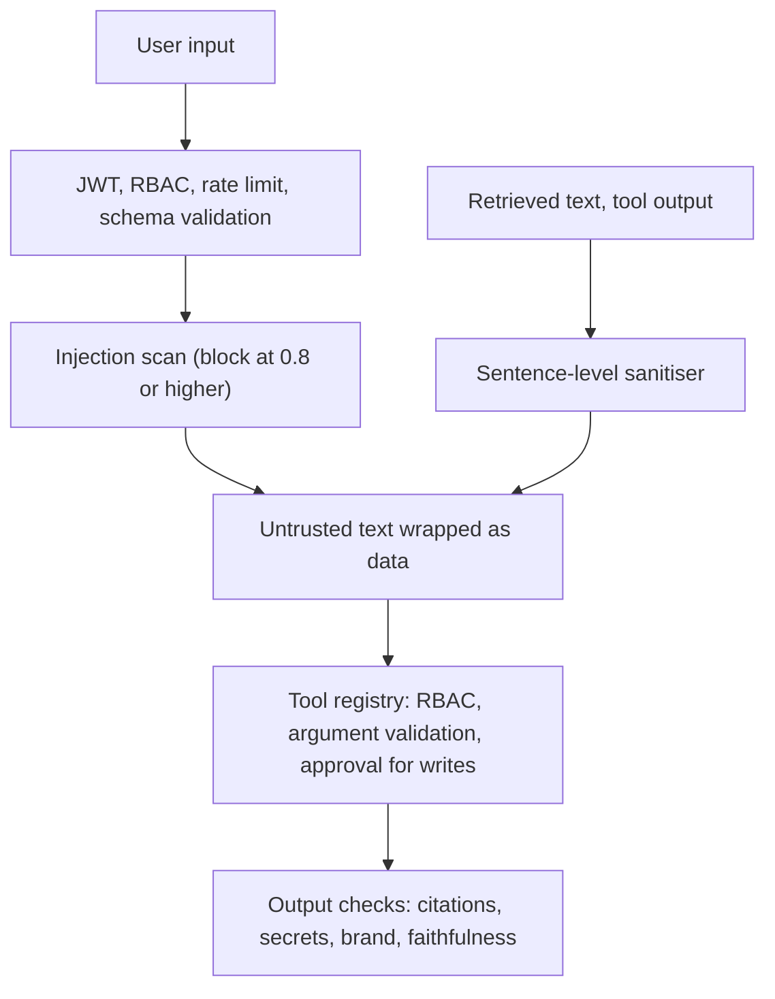

# Security

The injection detector is a tripwire, not the main defence. The controls that matter most do not depend on it:
the model can only ask the tool registry, which enforces permissions in code, and answers are checked after generation.

## Layers

## Roles

| Role | Chat and search | Analytics | MCP read tools | Write tools | Data tiers |
|---|---|---|---|---|---|
| viewer | yes | no | no | no | public, internal |
| analyst | yes | yes | yes | no | + confidential |
| administrator | yes | yes | yes | yes, after approval | + restricted |

Demo users: `viewer`/`viewer123`, `analyst`/`analyst123`, `admin`/`admin123`. For anything shared, change them and set a long random `JWT_SECRET`.

## Prompt injection

- **Direct:** user text is normalised and scored against instruction-override, role-hijack and exfiltration patterns. A score of 0.8 or more is blocked and audited.
- **Indirect:** retrieved text and MCP output are cleaned sentence by sentence. A sentence that looks like an instruction is removed and reported as a guardrail event. What remains is wrapped in tags, and the system prompt says tag contents are data.
- **Tool abuse:** the model never calls tools directly. Every call goes through one registry that checks the role, rate limit, argument schema and injection patterns, asks for approval on writes, applies a timeout, sanitises the output and writes an audit record.
- **Exfiltration:** no tool reaches the network, and output containing secrets, card numbers or the canary token fails validation.

## Guardrails

| Risk | Control |
|---|---|
| Unauthorised data | Namespaces and filters are built on the server from the role. The validator checks the tier of every cited document again. |
| Hallucinated citations | Cited ids must exist in this turn's evidence and be readable by the user. If evidence exists, at least one citation is required. An optional model-based faithfulness check runs too. |
| Invalid responses | Failed answers are regenerated up to twice, then repaired or replaced with a safe message. |
| Prompt leak | A canary token in the system prompt must never appear in the output. |
| PII and secrets | Card numbers (Luhn-checked) are redacted and credential patterns fail the turn. |
| Brand | Banned phrases are rejected, and a "not legal or regulatory advice" note is added when needed. |
| Unsafe tool execution | Write tools need human approval. The analysis tool only runs code that passes an AST allow-list, in an isolated subprocess with resource limits and a timeout. |

## Input validation

User requests are schema-validated (field-level 422 errors) and size-limited. Tool arguments have pydantic schemas. Retrieved content is sanitised before it reaches a prompt.

## Rate limiting

A token bucket per user, configured per role in `RATE_LIMITS` (`capacity` for bursts, `refill_per_sec` for the sustained rate), plus a separate bucket for tool calls.
An empty bucket returns 429 with `Retry-After`, and the UI shows a countdown.

## Human approval

Write tools pause the run at the `approval` node. An administrator approves or rejects, and the same run resumes. Rejections are recorded and the answer says the action was not taken.

## Audit

Denials, approvals, injection blocks and tool calls are written to an audit table. Administrators can read it at `GET /admin/audit`.

## Limitations

- Pattern-based detection can be evaded, which is why the other layers exist.
- Demo authentication is for local use only.
- The sandbox is process-level isolation, not a container.

Code: `app/security/` (rbac, auth, rate_limit, injection, guardrails, validation, safe_python, audit) and `app/tools/base.py`.
